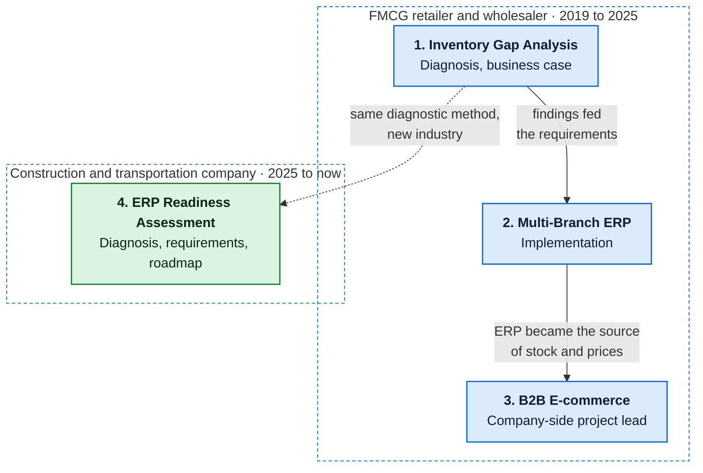

# Omar Ahmed Omar Alburiki

**Business Systems & Digital Solutions** · Business Analysis & Project Management · Riyadh, Saudi Arabia

I work where business operations meet the systems that run them. I analyze how a business actually works, design the processes and digital solutions it needs, and manage delivery with technology vendors through testing, go-live, and adoption. My work covers ERP readiness and implementation, B2B e-commerce, process improvement, and the move from manual, spreadsheet-based work to integrated systems.

8+ years of experience, 6+ in ERP and business systems, across distribution, retail, construction, and transportation. Each project below links to its case study and, where I can share one, a representative BRD.

## How the work connects

## Projects

### FMCG retailer and wholesaler, 2019 to 2025

#### 1. [Inventory Gap Analysis & ERP Readiness](https://github.com/omaralburiki/Inventory-Gap-Analysis-ERP-Readiness)
**ERP Business Analyst** · Nov 2019 – Apr 2020 · Part 1 of the ERP work

Measured inventory accuracy across 7 branches and 10,000+ SKUs, traced the gaps to their root causes, and built the business case that supported the decision to implement an ERP.

[Case study](https://github.com/omaralburiki/Inventory-Gap-Analysis-ERP-Readiness/blob/main/docs/Case-Study.md) · [Root cause analysis](https://github.com/omaralburiki/Inventory-Gap-Analysis-ERP-Readiness/blob/main/docs/Case-Study.md#from-8-gaps-to-5-root-causes)

#### 2. [Multi-Branch ERP Implementation](https://github.com/omaralburiki/Multi-Branch-ERP-Implementation)
**ERP Business Analyst** · Jun 2020 – Aug 2021 · Part 2 of the ERP work

Shared the business-side project management of a 7-module ERP rollout to 7 branches and 150+ users. Defined the requirements and BRD, designed company-wide business rules, and worked through UAT, user training, go-live, and stabilization.

[Case study](https://github.com/omaralburiki/Multi-Branch-ERP-Implementation/blob/main/docs/Case-Study.md) · [BRD](https://github.com/omaralburiki/Multi-Branch-ERP-Implementation/blob/main/docs/BRD.md) · [Business rules](https://github.com/omaralburiki/Multi-Branch-ERP-Implementation#the-rules)

#### 3. [B2B E-commerce Implementation](https://github.com/omaralburiki/B2B-E-commerce-Implementation)
**E-commerce Solutions Lead** · Feb 2023 – May 2025 · Built on the ERP from project 2

Led the project on the company side for a vendor-built B2B e-commerce platform that supported 500+ business customers. Owned release planning, vendor and change control, and the commercial design: customer access, pricing and credit tiers, delivery rules, and integrations.

[Case study](https://github.com/omaralburiki/B2B-E-commerce-Implementation/blob/main/docs/Case-Study.md) · [Requirements specification](https://github.com/omaralburiki/B2B-E-commerce-Implementation/blob/main/docs/BRD.md) · [How the project was led](https://github.com/omaralburiki/B2B-E-commerce-Implementation/blob/main/docs/Case-Study.md#leading-the-project)

### Construction and transportation company, 2025 to now

#### 4. [ERP Readiness Assessment: Construction & Transportation](https://github.com/omaralburiki/ERP-Readiness-Assessment-Construction-Transportation)
**Senior ERP Business Analyst** · Nov 2025 – Present · My current employer

Led the business side of an ERP readiness assessment across 8 departments, defined the future-state requirements in a BRD, and recommended a three-phase implementation roadmap. Now supporting vendor evaluation.

[Case study](https://github.com/omaralburiki/ERP-Readiness-Assessment-Construction-Transportation/blob/main/docs/Case-Study.md) · [BRD](https://github.com/omaralburiki/ERP-Readiness-Assessment-Construction-Transportation/blob/main/docs/BRD.md) · [TO-BE process](https://github.com/omaralburiki/ERP-Readiness-Assessment-Construction-Transportation/blob/main/docs/Case-Study.md#a-representative-to-be-process-procurement) · [Roadmap](https://github.com/omaralburiki/ERP-Readiness-Assessment-Construction-Transportation#recommended-scope)

## How I work

| Stage | What I do | Where to see it |
|---|---|---|
| Diagnosis | Readiness and gap assessments before a system is chosen | Projects 1 and 4 |
| Design | Requirements, BRDs, business rules, and solution design | Projects 2 and 3 |
| Decision | Release scope and priorities, phased ERP scope | Projects 3 and 4 |
| Delivery | Vendor direction, timelines, change requests, milestone payments, UAT and hands-on testing | Projects 2 and 3 |
| Adoption | Training, hypercare, stabilization, and handover to the departments that own the process | Project 2 |

The commercial side of these systems is part of the work too: pricing and credit tiers, onboarding new business accounts with the commercial team, and reviewing scope and commercial terms in contracts before signature. That experience carries over to any role where a customer's operating problem has to be matched to the right solution.

## Skills

| Business Analysis & Process Improvement | Project Management & Delivery | Business Systems & Digital Solutions |
|---|---|---|
| Stakeholder management and workshops | Release scope and prioritization | ERP readiness and implementation |
| BRD and functional requirements | Schedule, risk, and issue tracking | Business rules design |
| AS-IS and TO-BE process design | Vendor management | B2B e-commerce solution design |
| Gap analysis and root cause analysis | Change requests and milestone payment review | Commercial requirements: pricing, credit, delivery |
| UAT and acceptance testing | Pre-signature contract review | Integration requirements: ERP, payments, SMS, logistics |
| Process stabilization and handover | Status reporting, Jira | Shopify B2C stores and ERP integration (2019) |

Industries: FMCG and wholesale distribution, retail, B2B commerce, construction, transportation.

## Education & Professional Credentials

| Credential | Institution | Year |
|---|---|---|
| Project Management Professional (PMP) | PMI | 2026 |
| Membership, Specialist, Computer Science | Saudi Council of Engineers | Since 2020 |
| BSc Computer Science | Osmania University, India | 2017 |

Training: ITIL 4 Foundation course (2023), PMI-ACP course (2023).
